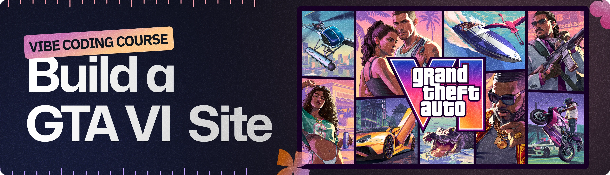
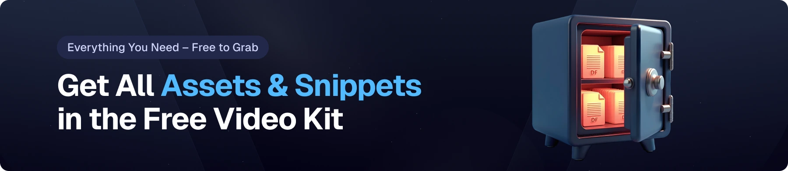
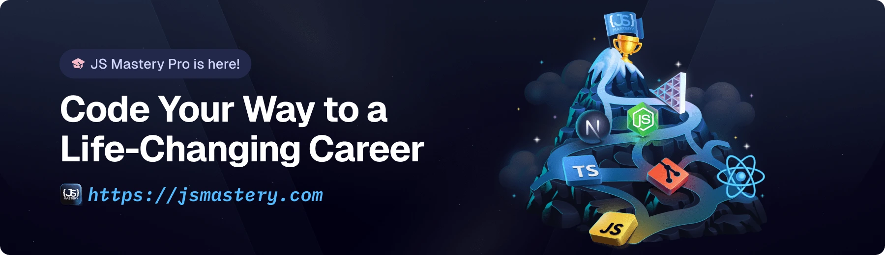

<div align="center">
  <br />
    <a href="https://youtu.be/dYUQY4LJoIg" target="_blank">
      
    </a>
  <br />

  <div>


  </div>

  <h3 align="center">GTA VI-Inspired Portfolio</h3>

   <div align="center">
     Build this project step by step with our detailed tutorial on <a href="https://www.youtube.com/watch?v=XUkNR-JfHwo" target="_blank"><b>JavaScript Mastery</b></a> YouTube. Join the JSM family!
    </div>
</div>

## 📋 <a name="table">Table of Contents</a>

1. ✨ [Introduction](#introduction)
2. ⚙️ [Tech Stack](#tech-stack)
3. 🔋 [Features](#features)
4. 🤸 [Quick Start](#quick-start)
5. 🔗 [Assets](#links)
6. 🚀 [More](#more)

## 🚨 Tutorial

This repository contains the code corresponding to an in-depth tutorial available on our YouTube channel, <a href="https://www.youtube.com/@javascriptmastery/videos" target="_blank"><b>JavaScript Mastery</b></a>.

If you prefer visual learning, this is the perfect resource for you. Follow our tutorial to learn how to build projects like these step-by-step in a beginner-friendly manner!

<a href="https://youtu.be/dYUQY4LJoIg" target="_blank"></a>

## <a name="introduction">✨ Introduction</a>

Grand Theft Developer is a cinematic, GTA VI-inspired developer portfolio built entirely with AI. It recreates the layout and motion of a game launch site: a layered hero intro, pinned scenes, scroll-scrubbed video backdrops and parallax promo cards. The content, artwork and videos are all original, so the result is a portfolio of your own, not a copy of someone else's site.

Built with React, GSAP and Lenis, the project shows how to study a reference site, measure its layout and timing, and rebuild its scroll animations frame by frame. All of the copy lives in a single content file, so you can make the site yours by editing one file and swapping the artwork.

If you're getting started and need assistance or face any bugs, join our active Discord community with over **50k+** members. It's a place where people help each other out.

<a href="https://discord.com/invite/n6EdbFJ" target="_blank"></a>

## <a name="tech-stack">⚙️ Tech Stack</a>

- **[GSAP](https://gsap.com/)** is a high-performance JavaScript animation library for building complex, timeline-based motion. Together with its ScrollTrigger plugin, it drives the hero intro, the pinned sections, the video scrubbing and the card parallax, all tied precisely to scroll position.

- **[Lenis](https://lenis.darkroom.engineering/)** is a lightweight smooth-scroll library that makes native scrolling feel fluid while keeping it accessible. It gives the portfolio its cinematic glide and stays in sync with GSAP's scroll-driven animations.

- **[React](https://react.dev/)** is a JavaScript library for building user interfaces from reusable components. It structures the portfolio into self-contained sections (Hero, Meet the Developer, Services, Miami, Highlights, Clients, Blog and Footer) that read their copy from a single content file.

- **[Tailwind CSS](https://tailwindcss.com/)** is a utility-first CSS framework for styling directly in your markup. It sits alongside component-level CSS here to handle the responsive layout, the type scale and the visual details across every breakpoint.

- **[Vite](https://vite.dev/)** is a fast frontend build tool with instant dev-server startup and hot module replacement. It powers local development and produces the optimized production build.

## <a name="features">🔋 Features</a>

👉 **Cinematic Loader**: A branded loading screen that waits for the fonts and hero artwork to decode before revealing the page, with a timeout fallback.

👉 **Layered Hero Intro**: Ten artwork pieces and logo layers animate onto a canvas, the content zooms into place, and the intro hands off seamlessly to a static poster with no flicker.

👉 **Scroll-Scrubbed Videos**: Videos play frame by frame as you scroll, decoded into memory with WebCodecs for smooth playback, with a seek-based fallback for iOS.

👉 **Portrait Video Renditions**: Phones in portrait get a 9:16 crop that follows the subject, built on the fly from a single hosted video.

👉 **Pinned Scenes**: The "Meet the Developer" section pins in place while a featured card and project cards scroll into view.

👉 **Parallax Promo Cards**: Cards scale up as they enter the viewport, their artwork drifts against the scroll, and on wide cards the image fade follows the pointer.

👉 **Responsive Carousels**: Card rows turn into swipeable, scroll-snapping carousels with drag support and page dots on smaller screens.

👉 **Cursor Glow**: A soft light behind the page follows the pointer and fades in and out between sections.

👉 **Smooth Scrolling**: Lenis-powered smooth scrolling keeps every animation fluid and in sync.

👉 **Single Content File**: All copy and links live in `src/content.js`, so you can personalize the whole portfolio without touching components.

👉 **Accessible by Default**: A static, readable version for `prefers-reduced-motion`, plus full keyboard navigation with visible focus outlines.

👉 **Fully Responsive**: Layouts, crops and motion are tuned for phones, tablets, laptops and ultra-wide screens.

And many more, including code architecture and reusability.

## <a name="quick-start">🤸 Quick Start</a>

Follow these steps to set up the project locally on your machine.

**Prerequisites**

Make sure you have the following installed on your machine:

- [Git](https://git-scm.com/)
- [Node.js](https://nodejs.org/en)
- [npm](https://www.npmjs.com/) (Node Package Manager)

**Cloning the Repository**

```bash
git clone [git remote URL]
```

**Installation**

Install the project dependencies using npm:

```bash
npm install
```

**Running the Project**

```bash
npm run dev
```

Open [http://localhost:5173](http://localhost:5173) in your browser to view the project.

## <a name="links">🔗 Assets</a>

Assets and snippets used in the project can be found in the **[video kit](https://jsmastery.com/video-kit/07817e83-03d3-4026-a9bc-fd74bb747218)**.

<a href="https://jsmastery.com/video-kit/07817e83-03d3-4026-a9bc-fd74bb747218" target="_blank">
  
</a>

## <a name="more">🚀 More</a>

**Advance your skills with our Pro Course**

Enjoyed creating this project? Dive deeper into our PRO courses for a richer learning adventure. They're packed with
detailed explanations, cool features, and exercises to boost your skills. Give it a go!

<a href="https://jsmastery.com/course/agentic-engineering-course" target="_blank">
  
</a>